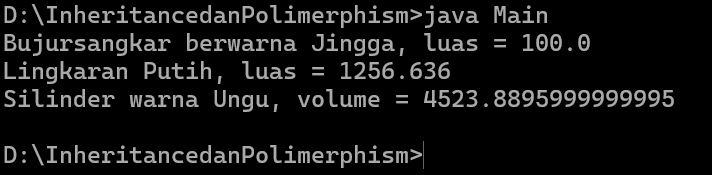

# Inheritance dan Polymorphism — Bentuk Geometri (Java)

Program Java berbasis OOP yang mendemonstrasikan konsep **Inheritance** (pewarisan) dan **Polymorphism** (method `printInfo()` yang dioverride di tiap kelas turunan) melalui hierarki kelas bentuk geometri.

Repository: [https://github.com/ZoeArc/Inheritance-dan-Polymorphism](https://github.com/ZoeArc/Inheritance-dan-Polymorphism)

---

## 📁 Struktur File

```
.
├── Bentuk.java         # Superclass: atribut warna dan printInfo()
├── BujurSangkar.java   # Turunan Bentuk: sisi dan luas
├── Lingkaran.java      # Turunan Bentuk: radius dan luas
├── Silinder.java       # Turunan Lingkaran: tinggi dan volume
├── Main.java           # Program utama
├── screenshots/
│   └── output.png      # Screenshot hasil program
└── README.md
```

## 🌳 Hierarki Kelas

```
Bentuk
├── BujurSangkar
└── Lingkaran
    └── Silinder
```

## 🧩 Deskripsi Kelas

| Kelas          | Turunan dari | Penjelasan |
| -------------- | ------------ | ---------- |
| `Bentuk`       | -            | Menyimpan atribut `warna` beserta getter, setter, dan `printInfo()`. |
| `BujurSangkar` | `Bentuk`     | Menambah atribut `sisi` dan method `hitungLuas()` (sisi × sisi). Meng-override `printInfo()`. |
| `Lingkaran`    | `Bentuk`     | Menambah atribut `radius`, konstanta `PHI = 3.14159`, dan method `hitungLuas()` (PHI × r²). Meng-override `printInfo()`. |
| `Silinder`     | `Lingkaran`  | Menambah atribut `tinggi` dan method `hitungVolume()` (luas alas × tinggi). Meng-override `printInfo()`. |
| `Main`         | -            | Membuat objek `BujurSangkar`, `Lingkaran`, dan `Silinder`, lalu memanggil `printInfo()` pada masing-masing. |

## 🔁 Konsep yang Digunakan

- **Inheritance**: `BujurSangkar` dan `Lingkaran` mewarisi `Bentuk`, sedangkan `Silinder` mewarisi `Lingkaran`. Konstruktor kelas turunan memanggil `super(...)`.
- **Method Overriding**: `printInfo()` ditulis ulang di setiap kelas turunan dengan output yang berbeda.
- **Polymorphism**: variabel bertipe `Bentuk` dapat menampung objek `BujurSangkar` atau `Lingkaran`, dan method yang dijalankan mengikuti tipe objek aslinya.
- **Konstanta**: `PHI` dideklarasikan `public static final` pada `Lingkaran`.

---

## 📦 Library Tambahan

**Tidak ada library tambahan.** Program hanya menggunakan fitur bawaan Java dan tidak memerlukan `import` apa pun.

---

## ⚙️ Cara Menjalankan

**Prasyarat:** JDK (Java Development Kit) 8 atau lebih baru.

1. Clone repository:
   ```bash
   git clone https://github.com/ZoeArc/Inheritance-dan-Polymorphism.git
   cd Inheritance-dan-Polymorphism
   ```
2. Compile semua file:
   ```bash
   javac *.java
   ```
3. Jalankan program:
   ```bash
   java Main
   ```

---

## 🖼️ Screenshot

### Hasil Output Program



### Data pada `Main.java`

| Objek        | Tipe Variabel | Tipe Objek     | Data                                 |
| ------------ | ------------- | -------------- | ------------------------------------ |
| `mySquare`   | `Bentuk`      | `BujurSangkar` | sisi 10.0, warna Jingga              |
| `myCircle`   | `Bentuk`      | `Lingkaran`    | radius 20.0, warna Putih             |
| `myCylinder` | `Lingkaran`   | `Silinder`     | tinggi 10.0, radius 12.0, warna Ungu |

---

## 📝 Catatan

- Urutan parameter konstruktor `Silinder` adalah `(tinggi, radius, warna)`.
- Nilai desimal pada output mengikuti perhitungan `double` di Java.

---

## 👤 Identitas

| Keterangan     | Isian |
| -------------- | ----- |
| Nama           |    Muhamad Alfian Maulana   |
| NIM            |   F1D02510077    |
| Kelas          |    3B   |
| Mata Kuliah    |    Pemrograman Berorientasi Objek   |
